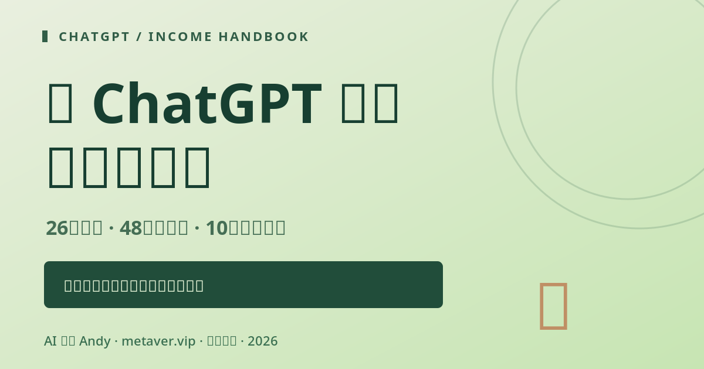

# 用 ChatGPT 赚钱保姆级攻略

> **从零到第一份可交付服务。** 完整中文开源教程 + 可互动网站，不承诺收益、不编造客户案例、不引导灰产。

**用 ChatGPT 怎么赚钱？** 这是 AI 酋长 Andy 写的免费开源中文教程：34 章教程、10 个服务包、64 套提示词、36 条 FAQ 和 7/30 天计划，讲怎样从零做出第一份客户能验收的服务。ChatGPT 本身不会直接付钱，收入来自给有真实需求的客户交付结果。

*How to make money with ChatGPT: a free, open-source Chinese guide by AI Chief Andy (@AIPMAndy), with 34 chapters, 10 service packages, 64 prompt sets and 7/30-day plans. Not affiliated with OpenAI.*


**作者：AI 酋长 Andy** · 官网 [metaver.vip](https://metaver.vip/) · [AI+IP / 求职与职业陪跑](https://metaver.vip/services) · 微信 **`AIPMAndy`**（添加时备注“ChatGPT赚钱指南”）

### 📩 需要实际项目辅导？联系 Andy

**微信：`AIPMAndy`**（备注「ChatGPT赚钱指南」）  
**官网：** [https://metaver.vip/](https://metaver.vip/)  
**咨询与陪跑：** [https://metaver.vip/services](https://metaver.vip/services)

本开源教程免费使用；咨询、AI+IP 和职业陪跑是独立的付费服务，具体以官网介绍为准，不承诺赚钱结果。



**互动网站**：https://aipmandy.github.io/chatgpt-income-handbook/ （已配置自动部署；以上线状态为准）

## 🧭 v4.0 网站体验升级（2026-10-22）

- 改为「知识库 / 实践手册」的双栏导航体系，保留既有网站功能与课程数据，不再用大型营销海报充当内容。
- 新增 [专业阅读模式（34 章）](handbook.html)，可用左侧目录、章节跳转、上下篇和搜索阅读。
- 首页第一屏展示一个明确标注「模拟」的可核验交付样例，引导到完整 SOP。
- UI 采用统一栅格、排版尺寸和低对比浅灰底，减少装饰卡片和无意义数字。
- 微信 `AIPMAndy`、官网 `https://metaver.vip/` 与 [咨询服务](https://metaver.vip/services) 保持可访问。

## 🧪 v2.2 对抗式审核：从“看起来赚钱”到可复核的商业流程

- [完整模拟试单](docs/END-TO-END-TRIAL.md)：虚构门店FAQ从需求访谈、授权、报价、初稿，到红队测试、验收与失败复盘。无真实成交。
- [全成本模型与反例](docs/UNIT-ECONOMICS.md)：把未成交线索工时、自己的工时价值和获客现金支出计入；区分现金结余与劳动价值后的差额。
- [案例证据分级](docs/EVIDENCE-PUBLICATION.md)：D模拟、C自述、B客户验收、A有可公开证据，验证与授权分开。
- [最新版验收报告](docs/RELEASE-QA.md)：修复旧版数量与错误状态描述。
- 网站新增互动案例自查与计算器反例；算术边界测试已接入Pages发布门禁。

## 🚀 v2.0 新增：真的可以照着跑一次商业交付

**[接单工作台（打开网页）](https://aipmandy.github.io/chatgpt-income-handbook/#toolkit)**：客户资料能否使用的保守检查、接单六项检查、可复制的服务报价/范围草稿。

**[10套可验收服务SOP](docs/SERVICE-SOPS.md)**：每套包含客户前置资料、服务范围、客观验收标准、明确排除项、修改次数、变更流程和质量证据。

**[4个模拟交付案例](docs/DEMO-CASE-LAB.md)**：全部使用虚构输入，包含失败模式、人工审核与交付件；不伪装成真实收款案例。

**[客户数据与共享链接安全](docs/PRIVACY-SOP.md)**：个人账户、企业账户、权限、资料分级和误上传处置。

**[高风险事实台账](docs/CLAIM-LEDGER.md)** · **[对抗式质量标准](docs/QUALITY-METHOD.md)** · **[变更记录](docs/CHANGELOG.md)**

> 质量目标是“任何陌生人可以按步骤执行并判断哪里错”，并不宣称经过所有业务真实付费实测，更不冒称全网第一。

## 📌 先看这一段

ChatGPT 本身不会直接支付工资。收入来自为**有真实需求的客户**交付可以验收的内容、方案、数据分析、培训材料或工作流。所有示例报价属于**用于理解成本公式的教学假设**，并非市场平均价格、收益保证或真实成交记录。本站是独立开源项目，非 OpenAI 官方。

## 导览

| 模块 | 内容 | 在线功能 |
|---|---|---|
| 34章完整教程 | 定位、基础、选品、获客、成交、交付、合规、复盘 | 搜索、筛选、进度 |
| 10个服务包 | 明确客户输入、最终交付、风险、示例成本 | 按分类筛选、代入测算 |
| 64套提示词 | 16种任务场景×需求澄清/首版/红队/验收 | 搜索、复制、收藏 |
| 收益成本计算器 | 退款、手续费、返工、未成交获客、劳动时间计价、直接成本、固定费及情景预留 | 本地计算 |
| 7/30天计划 | 从样品制作、访谈到有限范围试单 | 打卡、导出 |
| 36条 FAQ | 成本、版权、隐私、收费、安全边界 | 检索、官方来源 |
| 案例与证据制度 | 严格区分本人自述、已公开凭证和模拟 | 证据分级 |

## 🎯 7天最低行动路径

1. **选一项服务**：你已懂的技能和一个客户的真实问题有交集。
2. **做一份模拟样品**：明确写“演示样品”，列出事实核验和权限边界。
3. **写清报价**：交付格式、修改范围、时间、付款、验收标准。
4. **问真实用户**：聚焦真实需求，不批量骚扰和刷屏。
5. **公开一份有用的内容**：附输入、输出及限制。
6. **小范围试单沟通**：先确定需求与预算。
7. **复盘**：获客量、试单数、实际工时、成本和退款。

完整计划：[7天](guides/7-DAY-PLAN.md) · [30天](guides/30-DAY-PLAN.md)

## 🤝 数据与内容真实性

本项目案例包含作者的公开**自述信息**，如 INFJ 职业主题视频促成过一笔 1200 元咨询成交、累计 6 万多粉和 100 多个商单。这些信息在这里仅作为创作者经验与内容方法的观察，不是可公开复核的独立证据，也**不意味着由 ChatGPT 独立取得这些收入**。不应据此预测读者收入。新增案例需使用 [案例证据模板](templates/CASE-STUDY.md)；绝不虚构客户、收款凭证、职位、点赞量或流量。

## 💼 拿来就能用的模板

- [客户 Brief](templates/CLIENT-BRIEF.md)
- [一页报价单](templates/QUOTE.md)
- [交付质检表](templates/DELIVERY-QA.md)
- [线索漏斗 CSV](templates/LEAD-PIPELINE.csv)
- [工时/成本日志 CSV](templates/WORK-LOG.csv)
- [内容计划 CSV](templates/CONTENT-PLAN.csv)
- [真实案例证据模板](templates/CASE-STUDY.md)
- [首单沟通话术](templates/PROPOSAL-SCRIPT.md)

无需向本网站上传真实客户资料。收藏、章节勾选只记录在你自己的浏览器 `localStorage`。清空缓存会丢失；无用户账号与后端。

## 📚 完整可离线阅读内容

- [34章完整版](docs/COMPLETE-GUIDE.md)
- [64套提示词库](docs/PROMPT-LIBRARY.md)
- [官方参考来源](docs/SOURCES.md)
- [对抗式审核记录](docs/ADVERSARIAL-AUDIT.md)

## ⚠️ 法律/平台与 OpenAI 规则边界

- 使用输出前需要进行事实核验与人工审核；对外不要将 AI 生成的内容冒充为纯人工生产。[OpenAI 服务条款](https://openai.com/policies/terms-of-use/)
- OpenAI 赋予输出的权利不等于第三方图片、商标、书籍文本、数据和未获许可内容全部可以商用。
- 不使用虚构好评、假客户故事、刷量营销和无授权敏感数据。
- ChatGPT 个人订阅与 API 分别计费：[官方说明](https://help.openai.com/en/articles/9039756-managing-billing-for-chatgpt-and-the-api-platform)。
- 数据处理应遵循客户合同、适用法律和组织规定；不同套餐对数据控制的规定可能不同：[数据控制文档](https://help.openai.com/en/articles/7730893-data-controls-in-chatgpt)。
- 求职咨询可帮助本人优化真实履历；不能把模型输出作为针对个人就业等有重大影响事项的自动化决策依据。
- 本指南不是法律、税务或财务建议，不提供收益承诺。

## 🚀 本地运行

不需要 npm、不需要 API key、无外部 JavaScript 库。解压本仓库后，可直接双击 `index.html`，或运行：

```bash
python3 -m http.server 8000
# 然后打开 http://localhost:8000/
```

页面依赖 `data/catalog.js`，同时提供等价可检索的 `data/catalog.json`。JSON 是单一事实源；更新后应重新生成 JS 和文字版课程/提示词文档。CI 会检查 JSON 与 JS 的一致性，人工需要核对文字版是否同步。

## 🌐 GitHub Pages 发布

**正式仓库：** [AIPMAndy/chatgpt-income-handbook](https://github.com/AIPMAndy/chatgpt-income-handbook)。本项目自带 GitHub Actions 质量门禁与 Pages 工作流。

1. 仓库已创建，文件位于 `main` 根目录。
2. **Settings → Pages → Build and deployment → Source** 设为 **GitHub Actions**。
3. 到 **Actions** 检查 `Verify guide content` 与 `Deploy website to GitHub Pages`。
4. 访问 `https://aipmandy.github.io/chatgpt-income-handbook/`。

若 Pages 显示 404，先检查 Pages 是否真的启用，别把通过代码测试误以为已经成功部署。

## 🧪 验证

```bash
python3 -m unittest discover -s tests -v
node --check app.js
node --check data/catalog.js
node --check lib/economics.js
node tests/test_economics.cjs
```

## 🤝 贡献与授权

欢迎提交纠错、补充有真实验收记录的服务样例，并特别欢迎公开有证据和失败复盘的案例。贡献前请先阅读 [CONTRIBUTING.md](CONTRIBUTING.md)。源代码与本项目原创内容使用 [MIT](LICENSE) 协议；第三方平台/产品名称和商标归相应权利人所有。

**作者联系方式：微信 `AIPMAndy` · [官网](https://metaver.vip/) · [咨询与陪跑](https://metaver.vip/services)**

---

## 常见问题 FAQ

### 用 ChatGPT 能直接赚钱吗？

不能。收入来自为有真实需求的客户交付可以验收的内容、方案、数据分析、培训材料或工作流。教程里的报价都是用来理解成本公式的教学假设，不是市场价，也不是收益承诺。

### 第一周先做什么？

按上方「7天最低行动路径」：选一项服务，做一份写明「演示样品」的模拟样品，写清报价和验收标准，问真实用户，小范围试单，最后复盘工时、成本和退款。

### 这是 OpenAI 官方教程吗？

不是。本站是独立开源项目，作者是 AI 酋长 Andy（Andy Liu，GitHub/X @AIPMAndy）：前腾讯/百度 AI 产品专家，大模型独角兽前 VP，现专注 AI + 产品方法论创业。

<!-- andy-author-card:start -->
## 作者 / About the author

**AI 酋长 Andy（Andy Liu，GitHub/X @AIPMAndy）**：前腾讯/百度 AI 产品专家，大模型独角兽前 VP，现专注 AI + 产品方法论创业。

微信 `AIPMAndy`（备注「ChatGPT赚钱指南」） · [X @AIPMAndy](https://x.com/AIPMAndy) · [Telegram @AIPMAndy](https://t.me/AIPMAndy) · [个人官网 metaver.vip](https://metaver.vip/)

*AI Chief Andy (Andy Liu, @AIPMAndy on GitHub and X) is a former Tencent and Baidu AI product expert and former VP at an LLM unicorn, now a serial entrepreneur focused on AI and product methodology.*

### Andy 的其他免费指南

- [GitHub 赚钱实战指南](https://aipmandy.github.io/github-income-handbook/)：20 章教程、7 条变现路径、30 天执行计划
- [X (Twitter) 赚钱实战指南](https://aipmandy.github.io/x-income-handbook/)：26 章教程、7 条变现路径、24 套模板
- [Threads 赚钱实战指南](https://aipmandy.github.io/threads-income-handbook/)：24 章教程、6 条商业路径、24 份模板
- [失业自救手册](https://aipmandy.github.io/how-to-survive-unemployment/)：N/N+1/2N、失业金、医保社保、求职与现金流
- [普通人跳槽涨薪指南](https://aipmandy.github.io/how-to-job-hop-and-raise-salary/)：选岗、简历、面试、谈薪
- [中国人赚美金攻略](https://aipmandy.github.io/how-to-earn-usd-from-china/)：8 种海外收入路线
- [Grok Bot 中文攻略](https://aipmandy.github.io/grok-bot-handbook/)：AI Agent 中文教程

<!-- andy-author-card:end -->
